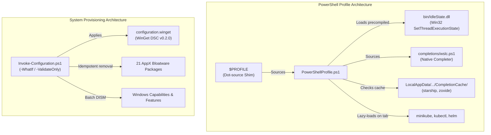

# PowerShell Profile & Workstation Configuration

A modern, high-performance PowerShell 7 profile and declarative Windows workstation configuration suite powered by **WinGet Configuration (DSC v0.2.0)** and native Win32 idle management.



---

## Key Highlights

- **⚡ Sub-300ms Shell Startup**: Bypasses slow repetitive CLI init runs using on-disk caching (`starship`, `zoxide`) and lazy-loads heavy completions (`kubectl`, `helm`, `minikube`) only on the first `<Tab>` press.
- **☕ Native Win32 Prevent-Idle**: Prevents system sleep and screen blanking via a precompiled 2.5 KB native assembly (`bin/IdleState.dll`) invoking `SetThreadExecutionState` with a named global mutex. **Zero child processes, zero polling loops, and zero simulated keystrokes**.
- **🔄 Live Git Profile Synchronization**: Uses a persistent dot-sourcing shim so modifications made in the repository take effect immediately in new terminal tabs without manual copying.
- **📦 Declarative WinGet Configuration**: Manages workstation software packages declaratively via `configuration.winget` and `winget configure`.
- **🛡️ Idempotent System Hardening**: Batches DISM operations for Windows Capabilities and Optional Features, and removes inbox AppX bloatware.
- **🐳 Contextual Container Completion**: Native tab completion for `wslc`, `docker`, and `wc` resolving container names, image tags, and subcommands.

---

## Directory Structure

```text
Profile/
├── .agents/
│   └── skills/
│       └── powershell-profile-formatting/   # Custom PowerShell style & formatting rules
├── bin/
│   └── IdleState.dll                       # Precompiled Win32 SetThreadExecutionState wrapper
├── completions/
│   └── wslc.ps1                            # Dynamic tab completer for wslc, docker, and wc
├── .gitignore                              # Git ignore rules for logs, temp, and OS files
├── configuration.winget                    # Declarative WinGet DSC v0.2.0 configuration
├── Invoke-Configuration.ps1                # Idempotent workstation provisioning bootstrapper
├── PowerShellProfile.ps1                   # Core interactive profile script
├── README.md                               # Project documentation
└── Sync-Profile.ps1                        # Profile bootstrap & synchronization utility
```

---

## Quick Start

### 1. Synchronize Profile
Run the sync script once to point your active PowerShell `$PROFILE` directly to the repository:

```powershell
.\Sync-Profile.ps1
```

Once linked, running `rsp` or opening any new PowerShell 7 terminal will automatically execute the repository profile.

### 2. Validate System Configuration
Verify the syntax and resources in `configuration.winget`:

```powershell
.\Invoke-Configuration.ps1 -ValidateOnly
```

### 3. Preview System Provisioning (Dry Run)
Inspect pending WinGet, AppX, and DISM changes without altering machine state:

```powershell
.\Invoke-Configuration.ps1 -WhatIf
```

### 4. Apply System Provisioning
From an **elevated** (Administrator) PowerShell terminal:

```powershell
.\Invoke-Configuration.ps1
```

---

## Profile Utilities & Aliases Reference

All functions and filters provide full comment-based help. Run `Get-Help <Command> -Full` for complete parameter and example details.

| Alias | Target Command | Type | Description | Example |
| :--- | :--- | :--- | :--- | :--- |
| `scf` | `Stop-ComputerForce` | Function | Immediately shuts down machine without prompting. | `scf` |
| `rcf` | `Restart-ComputerForce` | Function | Immediately reboots machine without prompting. | `rcf` |
| `rsp` | `Restart-Profile` | Function | Reloads `$PROFILE` into the active session. | `rsp` |
| `fla` | `Format-ListAll` | Filter | Formats piped objects displaying all properties. | `Get-Process explorer \| fla` |
| `eo` | `Expand-Object` | Filter | Unwraps and outputs raw property values. | `Get-Service \| eo Name` |
| `b64e` | `ConvertTo-Base64` | Filter | Encodes UTF-8 string to standard or URL-safe Base64. | `'test' \| b64e -UrlSafe` |
| `b64d` | `ConvertFrom-Base64` | Filter | Decodes standard or URL-safe Base64 to string. | `'dGVzdA' \| b64d` |
| `lsf` | `Get-ChildItemForce` | Filter | Lists directory contents including hidden/system files. | `lsf` or `lsf C:\Windows` |
| `lsa` | `Get-ChildItemAll` | Filter | Recursively searches directory tree for pattern. | `lsa 'hosts'` |
| `rf` | `ConvertTo-DangerousURI` | Filter | Restores defanged URLs (`hxxp://`, `[.]`) to live URIs. | `'hxxps://ex[.]com' \| rf` |
| `df` | `ConvertTo-SafeURI` | Filter | Defangs live URLs to prevent accidental clicks. | `'https://ex.com' \| df` |
| — | `Hide-Item` | Filter | Sets the `Hidden` attribute on files or folders. | `Hide-Item .\secret.env` |
| — | `Get-NixOSWSL` | Function | Downloads & imports NixOS-WSL rootfs into WSL 2. | `Get-NixOSWSL -AsDefault` |
| `chef` | `Start-LocalCyberChef` | Function | Downloads/extracts & launches local offline CyberChef. | `chef` |
| — | `Enable-PreventIdle` | Function | Prevents system/display sleep via Win32 API. | `Enable-PreventIdle` |
| — | `Disable-PreventIdle` | Function | Restores normal Windows idle and sleep behavior. | `Disable-PreventIdle` |
| `cat` | `bat` | Alias | Syntax-highlighting cat utility. | `cat .\README.md` |
| `vi` / `vim` | `nvim` | Alias | Neovim editor. | `vi .\file.txt` |
| `ghd` | `GithubDesktop` | Alias | Launches GitHub Desktop. | `ghd` |
| `s` | `Set-Clipboard` | Alias | Pipes standard output to system clipboard. | `'secret' \| s` |
| `docker` / `wc` | `wslc` | Alias | Aliases Docker CLI to WSL container CLI. | `docker ps` |
| `gj` / `rcj` | `Get-Job` / `Receive-Job` | Alias | Background job inspection. | `gj` |
| `sj` / `rj` | `Stop-Job` / `Remove-Job` | Alias | Background job management. | `sj -Name worker` |

---

## Startup Caching Architecture

PowerShell interactive startup latency is optimized through a two-tiered caching model located at `%LOCALAPPDATA%\PowerShell\CompletionCache`:

1. **Compiled Assembly (`bin/IdleState.dll`)**:
   - `Enable-PreventIdle` loads `bin/IdleState.dll` directly. Precompiling avoids invoking the Roslyn C# compiler (`csc.exe`) during shell startup, saving ~500ms on every launch.
2. **Tool Initialization Cache (`starship-init.ps1`, `zoxide-init.ps1`)**:
   - Evaluates the modification timestamp (`LastWriteTimeUtc`) of the executable against the cached script.
   - Re-generates the script only when the tool binary has been upgraded; otherwise dot-sources the cached script directly.
3. **Lazy-Loaded Completions (`minikube`, `kubectl`, `helm`)**:
   - Instead of evaluating large completion generation scripts on startup (~200–400ms each), lightweight native argument completers are registered.
   - When the user presses `<Tab>` on one of these commands for the first time, the completion script is generated, cached on disk, and dot-sourced dynamically.

---

## Style & Contributing Conventions

All PowerShell code in this repository strictly adheres to the conventions defined in [.agents/skills/powershell-profile-formatting/SKILL.md](.agents/skills/powershell-profile-formatting/SKILL.md):
- **PascalCase Keywords**: `If`, `Else`, `Param`, `Filter`, `Function`, `Return`, `ForEach`, `$True`, `$False`, `$Null`, `$PSItem`, etc.
- **One True Brace Style (OTBS)**: Opening brace `{` on the same line with a space.
- **Stacked Parameter Attributes**: Attribute brackets, types, and parameter names stacked vertically on separate lines.
- **Aligned Hashtables**: Assignment operators (`=`) vertically aligned by padding keys.
- **Full Cmdlet Names & Explicit Parameters**: No cryptic aliases inside scripts (`Get-ChildItem` instead of `ls` or `dir`).
